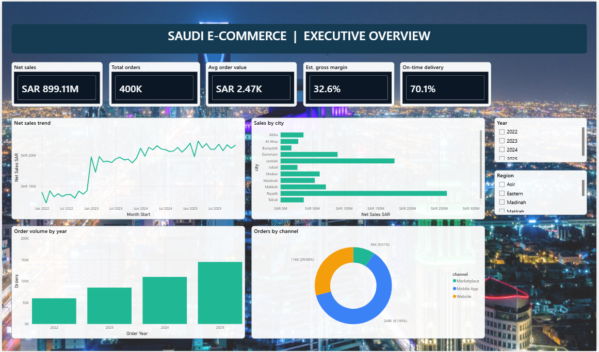

# Saudi E-Commerce & Last-Mile Delivery Analytics

**An independent analytics project using Python, MySQL, Power BI and Excel**

I wanted to build something beyond a dashboard that simply shows sales figures. I chose a fictional Saudi e-commerce business and looked at how sales, customer activity and deliveries fit together. My main question was simple: **if orders are increasing, is the business actually doing better?**

I worked with a synthetic dataset covering 2022–2025: **400,000 orders, 160,000 customers, 4,000 products, 1 million order items and 400,000 delivery records**. The data is simulated, not taken from a real company, so the results are useful for demonstrating analysis rather than describing the actual Saudi market.

## What I found

The biggest thing I noticed was the difference between order growth and sales growth.

| Metric | 2024 | 2025 | Change |
|---|---:|---:|---:|
| Orders | 110,000 | 145,000 | **+31.8%** |
| Delivered sales | SAR 250.41M | SAR 255.63M | **+2.1%** |
| Average delivered order value | SAR 2,474 | SAR 1,976 | **−20.1%** |

The business was handling considerably more orders, but the value of each delivered order was falling. I wouldn't assume this was caused by discounting or customers buying cheaper products without checking the underlying data. In fact, the synthetic data generator changes the number of items per order over time, which contributes to this pattern.

**My takeaway:** Looking only at the number of orders can make growth look stronger than it really is. I'd want to understand average basket size, discounts and product mix before recommending more spending to acquire customers.

## Other things that stood out

**Delivery delays:** About **29.9%** of completed deliveries were late in the simulated data. The five delivery partners had very similar late rates (roughly 29.7%–30.3%), so I wouldn't single out one company. I would start by checking promised delivery times, warehouse locations and routes.

**Where sales come from:** Riyadh, Jeddah and Dammam made up about **59.1%** of delivered sales across the four years. The mobile app accounted for about **61.8%**. I would look at these areas and channels first when investigating customer experience and profitability, while keeping in mind that the geographic split is simulated.

**Product categories:** Electronics and Home & Kitchen contributed about **70.1%** of gross item sales on delivered orders. That makes them important categories to examine, but high sales do not necessarily mean high profit once discounts and fulfillment costs are considered.

## What I would suggest to the business

1. **Find out why order value is dropping.** Compare basket size, discounts and product categories across years and customer groups. If the numbers support it, test bundles or relevant cross-selling rather than offering broad discounts.
2. **Work on delivery reliability.** Look for patterns in late deliveries by city, warehouse and promised delivery window. I'd test clearer delivery promises and earlier alerts for delayed shipments before changing carriers.
3. **Focus on profitable growth.** Compare channels and categories using contribution after discounts and delivery costs, not just total sales.
4. **Measure whether changes actually help.** Start with small tests and compare results before rolling anything out widely.

These are my recommendations based on the case study, not changes I implemented or financial improvements I achieved.

For a closer look at how I reached these conclusions, see my [business insights and recommendations](reports/BUSINESS_INSIGHTS_AND_ACTION_PLAN.md).

## Power BI dashboards

I organized the report into six pages, each looking at a different part of the business.

| Dashboard | What I explored |
|---|---|
| [Executive Overview](screenshots/01_executive_overview.png) | Overall sales, orders and delivery performance |
| [Sales & Profitability](screenshots/02_sales_profitability.png) | Sales trends, product categories and estimated margins |
| [Customer Intelligence](screenshots/03_customer_intelligence.png) | Customer activity and repeat purchases |
| [Delivery & Logistics](screenshots/04_delivery_logistics.png) | Delivery time, costs and partner performance |
| [Order Quality](screenshots/05_order_quality.png) | Cancellations and returns |
| [Business Opportunities](screenshots/06_business_opportunities.png) | Areas worth investigating and testing |



## What's included in this repository

| Files | Purpose |
|---|---|
| [Power BI project](Saudi_Ecommerce.pbip) and `Saudi_Ecommerce.Report/`, `Saudi_Ecommerce.SemanticModel/` | Editable report and data model |
| [SQL scripts](mysql/) | Database schema, loading, quality checks and business queries |
| [Python scripts](python/) | Generate synthetic data, load MySQL, validate data and rebuild summaries |
| [Analysis outputs](analysis/) | Saved KPI calculations and data checks |
| [Data dictionary and samples](data/) | Table definitions and sample CSVs |
| [Excel scenario model](excel/Business_Impact_Scenarios.xlsx) | Exploring possible improvements under assumptions |
| [Executive report](reports/Executive_Analysis_and_Recommendations.pdf) | PDF summary |
| [Business insights](reports/BUSINESS_INSIGHTS_AND_ACTION_PLAN.md) | My interpretation and suggested next steps |
| [Setup guide](docs/SETUP.md) | How to reproduce the project |

## How to run it

The full synthetic dataset is generated locally rather than stored in GitHub.

```bash
pip install -r requirements.txt
python python/generate_synthetic_data.py
python python/validate_dataset.py
```

For MySQL, run `mysql/01_schema.sql` and then `python python/load_mysql.py --host localhost --user root`. Open `Saudi_Ecommerce.pbip` in Power BI Desktop and configure the MySQL connection. Full instructions are in [docs/SETUP.md](docs/SETUP.md).

If rerunning the generator, first move or delete the previous `data/saudi_ecommerce.sqlite` file; it creates tables from scratch.

## A note about the data

This is an **independent portfolio project built on fictional data**. The trends were created through a synthetic data generator, so I am not presenting them as findings about real Saudi businesses or delivery companies. Delivered sales refer to orders marked `Delivered`; estimated product margin is not net profit. The Excel workbook explores hypothetical scenarios, not actual savings.

The report files are included, but opening and refreshing the full Power BI project on another computer still needs to be checked locally.
